# OWLOS WiFi Radar

Passive WiFi radar for ESP32 boards with a screen. It listens on 2.4 GHz and draws every network around as a blip on old school radar screen - name, signal, and direction when it can figure it out.

**Flash it online, right from the browser: https://kirindenis.github.io/OWLOS-WIFI-RADAR/** - pick your board, press the button, done. No toolchain, just Chrome or Edge on a computer and a USB cable.

It started on the "cheap yellow display" (CYD), a 2.8" 320x240 ESP32 board with resistive touch, and now runs on all the screens of my ViewOwl project too: 3.5" 480x320, a round 1.28" one and two e-papers. Which one is picked in `core/config.h` (or by the build script, see below).

<p>
  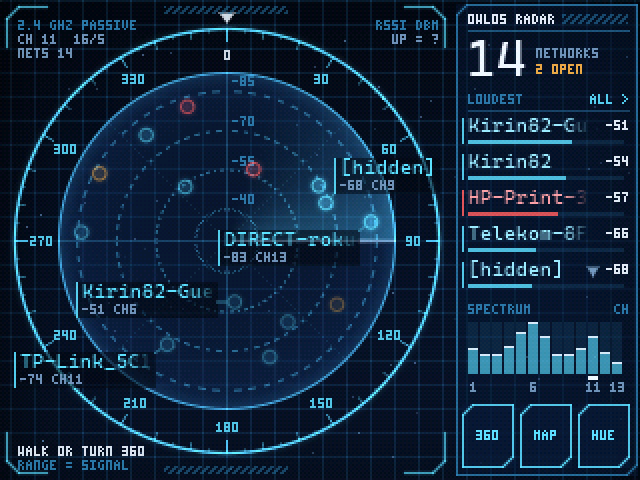
  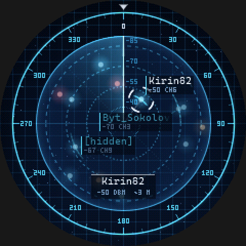
  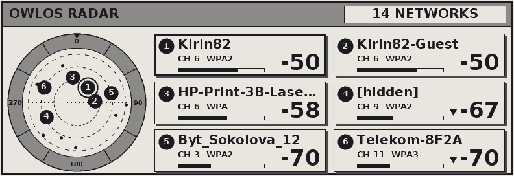
</p>

## Idea

List of networks with bars is boring. I wanted to walk around the flat with the board and actually *see* where the routers are. When you walk some signals go up and some go down, so with enough of this data you can guess where they sit. The radar tries to do exactly that, and to be honest on screen about what it doesnt know.

## What it shows

- Distance from center is signal strength. Dashed rings are -40, -55, -70 and -85 dBm. Close/loud is in the middle.
- Color is security: cyan = WPA2/WPA3, amber = open, red = WEP or old WPA. White is for "focus" things (beam edge, selected target).
- Hollow ring = network without known direction yet. It just stays on its range ring at fixed place, it does not pretend to know where it is.
- Solid glowing dot = direction is known, with a small arc showing how unsure it is.
- The beam leaves phosphor trail, dots flash when beam goes over them. Pure looks, but its nice.

## Getting direction

Signal strength alone tells you "how loud", never "from where". There are two ways the radar finds the direction.

**1. Walk.** Just walk slowly through all rooms for a minute or two (MAP button shows it live). Once a second the radar saves level of every network and then solves two things at same time: where you were each second, and where each router is, so that one path loss formula explains all the snapshots best. It's basically WiFi SLAM in the simplest form, code is in `core/map.c`. The trick that makes it work is that a person moves about 1 m per second, so the path must be smooth.

A walk cant tell left from right (mirror image of the map fits the levels exactly the same), so:

**2. Turn 360.** Hold the board at your chest, hold BOOT (or press 360), and turn slowly on the spot following the beam - one full turn in 24 s. Your body blocks 2.4 GHz quite well (5-15 dB), so each network is loudest when you face it. A first harmonic fit over the turn gives the direction. If you do the turn during a walk, it also fixes left/right of the map. While turning you see the "lobe" of the loudest network growing towards it.

<p>
  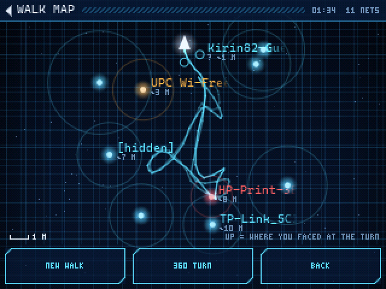
  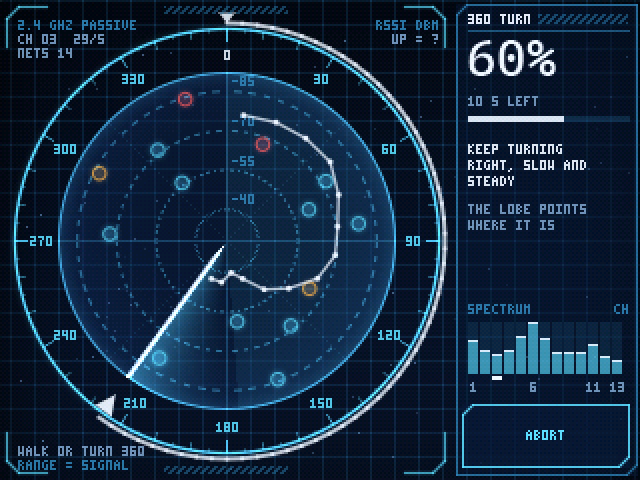
</p>

How good is it? In my simulated flat (10x7 m, walls, neighbours behind walls, one router a floor above, your own body shading things, weak beacons getting lost like in real life) the turn gives about 5-11 degrees error, the walk finds the path within ~1.2 m and directions to the networks it trusts within 10-30 degrees. Real flat is worse because of reflections - the direction points where the signal *comes from*, wich is still the way to walk.

If you just leave the board on the table it will not draw a fake map: there is a check how much of the level changes is really explained by moving.

## Screens

Tap on a dot - it becomes the target. Tap on empty radar - radar goes fullscreen. Swipe left/right to go through the views, tap the header to go back. Here: the full screen radar, hunting one network (big numbers, warmer/colder while you walk), the list (sortable by signal, name or channel, drag to scroll) and the spectrum like WiFi analyzer apps draw it (tap a channel to see who sits there):

<p>
  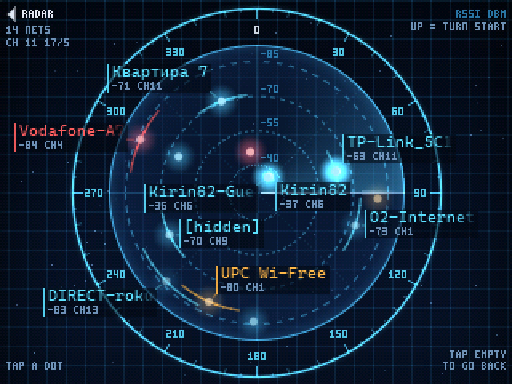
  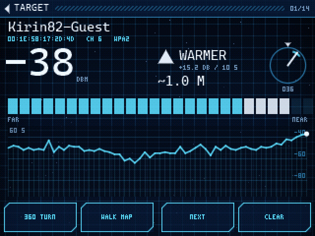
  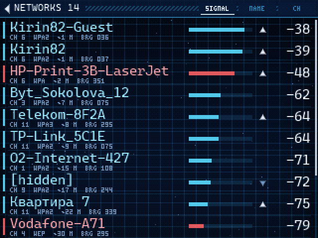
  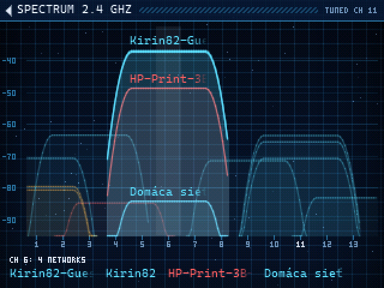
</p>

HUE button cycles 5 color themes: arctic, phosphor green, amber, crimson, synth. Theme is remembered.

<p>
  
  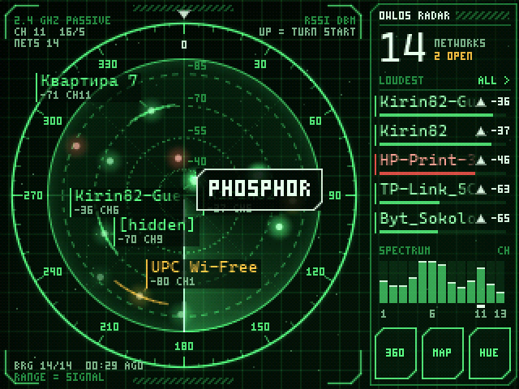
  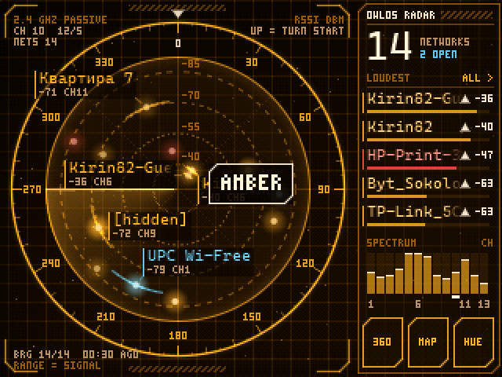
  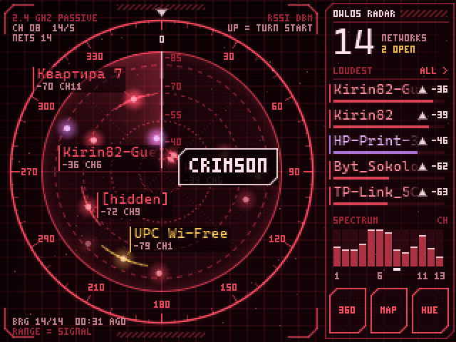
  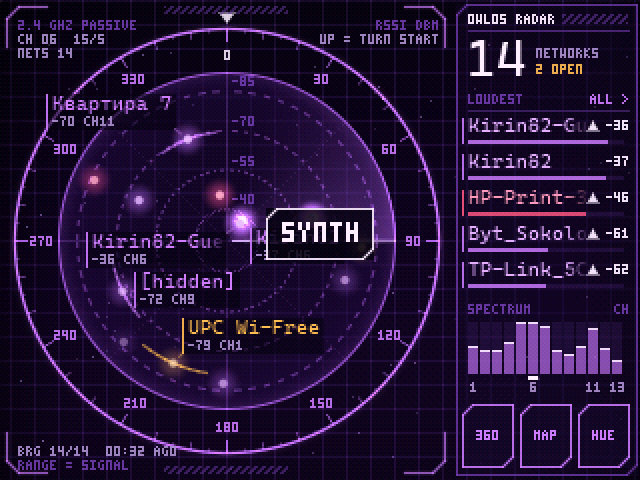
</p>

BOOT button still works too: short press = next target, long press = 360 turn.

## Other screens

The layout is worked out from the screen size, so nothing is drawn for 320x240 only. Bigger screens just get more room - 480x320:

<p>
  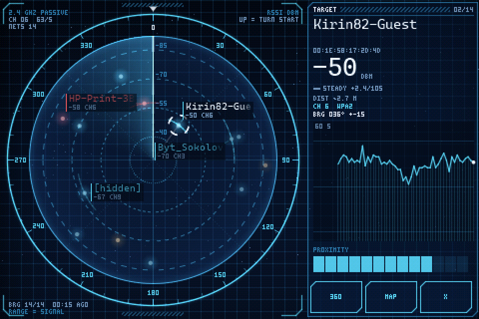
  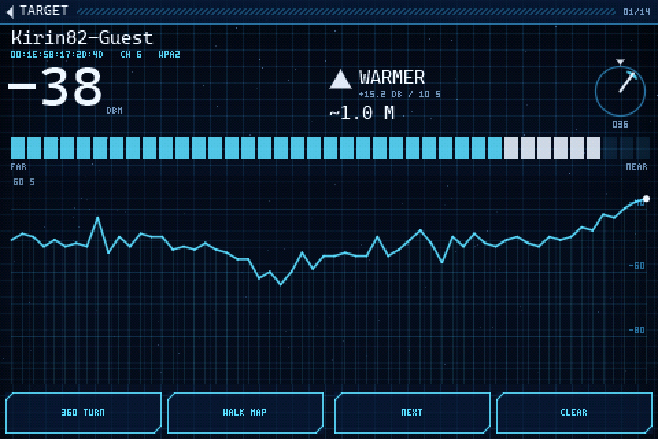
</p>

**Round 1.28"** has no corners, so it got its own views. The main screen is the radar itself, a tap on the empty radar opens the target (or the list), the top of the glass is back. On the hunt screen the closeness goes around the edge:

<p>
  
  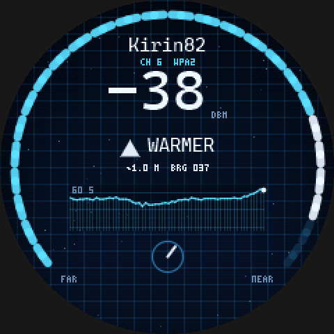
  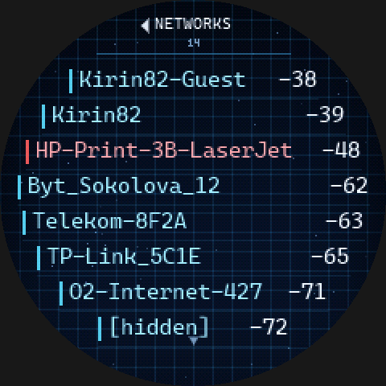
  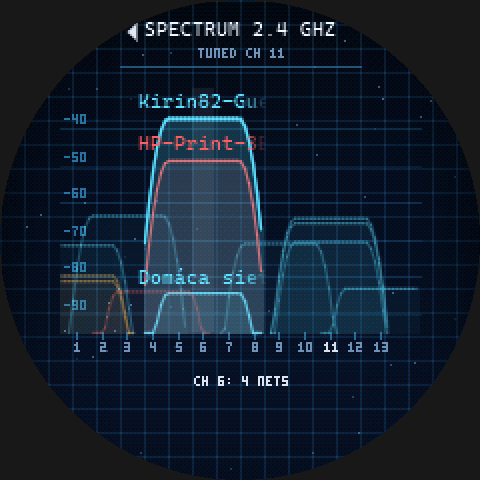
</p>

How to drive the round one (it took me a moment too):

- There are four screens in a ring: radar, list, spectrum, walk map. **Swipe left** for the next one, **swipe right** to go back. A swipe is a mostly sideways move, about a third of the glass long.
- **Tap the top edge of the glass** (where the screen title is) to go back to the radar from anywhere.
- On the radar: **tap a dot** and it becomes the target. **Tap empty radar** to open the hunt screen for the target, or the list if there is no target yet. **Hold a finger on the radar** for a second to change the colors (there is no HUE button here).
- In the list: **tap a row** to make it the target and open its hunt screen, **drag** up or down to scroll.
- On the spectrum: **tap a channel** to see who sits on it.
- On the hunt screen and the map: **tap anywhere** to go back to the radar.
- **BOOT button**: short press = next network (after the quietest one the target is dropped), long press = start or stop the 360 turn.
- Touch misses? Hold a finger still anywhere for 4 seconds, the 5 crosses come back.

**E-paper** (4.2" 400x300 and 5.79" 792x272) got its own main screen, made like the plates of my ViewOwl project: white sheet, black frame, a light grey header band, cards with a dark grey shadow, bold type (DejaVu Sans Bold). It took three tries, what the real panel taught:

- Big, and smooth with the panel's own greys. The letters' soft edges are rounded to the two greys the glass has, no dithering (dithered edges printed as fuzz). Names are 20 px, the numbers 34 px, the target's level 63 px.
- Few things. Six networks on cards, readable from a metre, not a table of twenty.
- The radar has no labels, each dot carries the number of its card. A legend reads better than words squeezed between dots. Two routers in one box sit on the same spot, so a badge that would cover another one moves aside with a thin line back to its dot.
- Grey only where nothing ever changes (the bands, the shadows, the radar's ring). Everything that changes is black on white, because changes are drawn on top.

<p>
  
  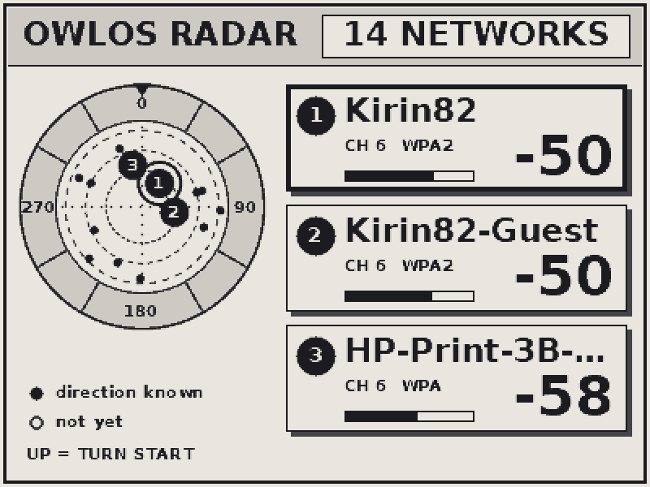
</p>

Greys need a full refresh (~3 s, it flashes), so that happens only for a new screen and every 10 minutes. In between a new picture is made every 5 s and only what changed is drawn on top with a partial refresh: black and white, no flash, about 2 s, and the pixels that didn't change keep their grey. If nothing changed the glass isn't touched at all. The driver keeps a model of what really is on the glass, so it knows how many pixels show a wrong grey after the partials. When that gets over 8000 it does a full refresh, but not more often than every 3 minutes (the soft edges of changing digits alone make 2000-4000, those don't matter, they just turn crisp; the grey fills do). The two 54 KB pictures live in the S3's PSRAM.

The graphs (channels, the target's last minute) fit their dB scale to what is there, in 10 dB steps. With a fixed -30..-95 everything real (-70..-92) lay on the bottom. Under the curves there is a halftone, like ViewOwl's graph fills: a grey the panel doesn't have is made of its two nearest greys in a bayer pattern, at draw time. The greys are the ones the glass really shows (measured in ViewOwl: 0/60/140/255 on the 5.79", 0/50/220/255 on the 4.2"), every pixel goes to the nearest of them, no dithering. ViewOwl never had a partial refresh on the 5.79" cascade, this is the first one.

MENU goes thru the other paper screens, made the same way: the hunt for one network (instead of a big radar, the main screen has one already) with the level as big as the panel allows, warmer or colder, closeness, the last minute and an arrow where it is; the list in two columns, the page with the target on it; channels, one hump a network with names on the loudest peaks and which channels are crowded; the walk map, numbered like the cards, with how far each one is.

<p>
  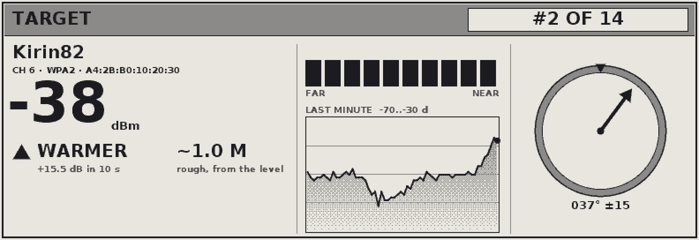
  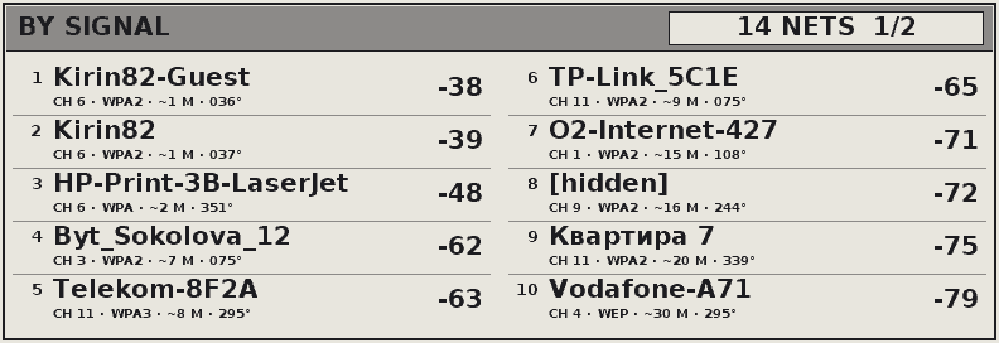
</p>
<p>
  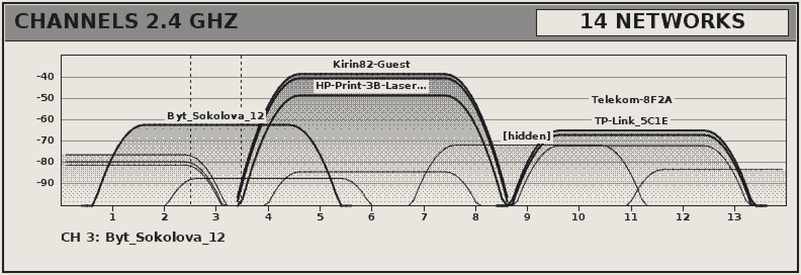
  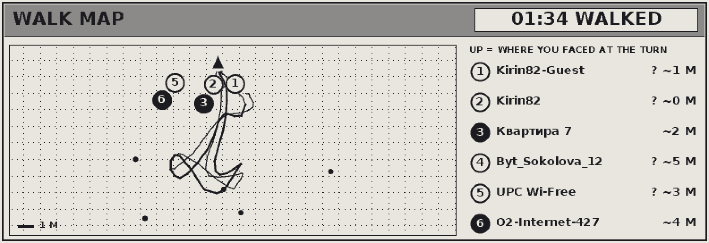
</p>

The keys, enough with just the two side ones: **MENU** = next screen, **hold MENU** = 360 turn, **BACK** on the main screen = next network (after the last one the target is dropped), on other screens = back. The dial, where there is one: up/down picks a network, pressing it opens the target, holding it starts the turn.

## Touch

First start asks to tap 5 crosses (press and hold each, nail or stylus works best). On my board the touch axes are swapped and both go backwards compared to the screen, so without calibration only the biggest button was clickable. If it ever goes wrong, hold a finger anywhere for 4 seconds and calibration starts again. A small ring under the finger shows where the touch is read. The round board does the same once, there it finds out how its touch chip is turned.

## Saved data

Walk map and the list of networks are saved to the ESP32 internal flash (own 512 KB partition, used as a ring of 12 KB slots so flash doesnt wear out). Every 3 minutes and few seconds after a turn or new walk. After power on the radar continues where it was. Restored networks are drawn faded until they are heard again.

## Hardware

Pins for all of them are in `firmware/main/board.h`, the same wiring as in ViewOwl's firmware for each screen.

- **ili9341** - the 2.8" CYD ("cheap yellow display", in shops as ESP32-2432S028R): classic ESP32, ILI9341 320x240 on SPI, XPT2046 touch on its own pins (CLK 25, MOSI 32, MISO 39, CS 33, IRQ 36). LCD: SCLK 14, MOSI 13, DC 2, CS 15, RST tied high, backlight 21. Runs 15-19 fps, ran 2 hours without a hiccup.
- **st7796** - the 3.5" CYD (in shops as ESP32-3248S035), ST7796 480x320. The touch is the XPT2046 sitting on the LCD's own SPI bus (CS 33), works fine. About 8 fps: bigger radar to draw, and with no PSRAM only 24 KB heap are left, so the strips are 12 rows.
- **ili9486** - Waveshare RPi LCD (A) 3.5" on the OWLOSAirQuality board. That board talks to the panel thru shift registers, so every command byte is sent as 16 bits with its own CS pulse, 20 MHz max. No touch, BOOT button only.
- **gc9a01** - Elecrow CrowPanel 1.28" round, ESP32-C3. Reset and backlight sit on an I2C expander. The touch chip isnt named anywhere I could find, CST816 at 0x15 was a guess and it answered (if nothing answers the radar goes on without touch). About 8 fps, the C3 has one core and no FPU, most of the frame goes to the blips.
- **epd400 / epd792** - Elecrow CrowPanel e-paper 4.2" and 5.79", ESP32-S3, SSD1683 bit-banged. The 5.79" is two controllers in a cascade, a 4-grey refresh takes 3.3 s there. The two side keys are MENU (GPIO 2) and BACK (GPIO 1), the dial is on 6/4/5 (up/down/press), pins from Elecrow's example. The strips are only 8 rows here: 792 x 24 rows was a 76 KB buffer and after wifi there is no free block that big.

There is no PSRAM on most of these, and a full 320x240x16 frame (150 KB) doesnt fit in one RAM block, so the picture is never stored whole. It is drawn in strips of 24 rows (12 on the 480 wide ones), dithered to RGB565 and sent with DMA while the next strip is drawn.

A few things I found on the way, maybe useful for somebody with same board:
- 80 MHz flash made the CYD hang randomly, so it runs at 40 MHz.
- Sending next strip while the previous one is still in flight can deadlock esp_lcd driver (seen in a core dump: stuck in `spi_device_acquire_bus`). Now it waits for the "done" callback first.
- `touch_init`/`touch_read` names clash with something inside ESP-IDF's librtc.a, so the touch functions are `tp_*`.
- The walk map solver tries a few fresh starts every 20 s, about a second of maths. It shares core 0 with the wifi, and next to a busy router the wifi took so much of it that the second grew to ten: the idle task never ran and the task watchdog rebooted the board, again and again. Now the solver gives the core back after every round (`map_yield` in `core/map.h`).
- Reading the touch once a frame is fine at 16 fps but not at 8: a swipe gave one or two points and came out as a tap. Now it is read between the strips too, every 15 ms or so.
- Opening the serial port resets the board.

## Flash it from the browser

No toolchain needed: **https://kirindenis.github.io/OWLOS-WIFI-RADAR/** has a button for every board. Chrome or Edge on a computer, a USB cable, pick the port, say yes to erase. It's [ESP Web Tools](https://esphome.github.io/esp-web-tools/) over Web Serial, the same thing ViewOwl's flasher uses.

The firmware there is built by GitHub Actions on every push to `main` (`.github/workflows/pages.yml`): one job per screen in parallel, in Espressif's own ESP-IDF 5.5 docker image, then one job puts the page (`site/`), the screenshots and the binaries together and publishes them on GitHub Pages. The addresses in the flasher manifests come from the build's own `flash_args` (`.github/make-manifests.sh`), so the bootloader goes to 0x1000 on the ESP32 and to 0 on the C3 and S3 without anybody typing it. For a fork: Settings -> Pages -> Source: GitHub Actions, once.

## Build

Needs ESP-IDF 5.5.

```
firmware\BUILD.BAT                 build for the 2.8" CYD
firmware\BUILD.BAT COM7            build, flash and open monitor
firmware\BUILD.BAT gc9a01          build for another screen
firmware\BUILD.BAT epd400 COM9     same and flash it
```

Screens: `ili9341`, `st7796`, `ili9486`, `gc9a01`, `epd400`, `epd792`. Each one gets its own build folder and sdkconfig, the C3 and S3 ones use a 2 MB partition table.

The radio is passive only - it never transmits anything (no probe requests, no association), just listens to beacons and to the headers of data frames coming from access points. Payloads are not touched.

## PC preview

All the drawing and the math (`core/`) is plain C and compiles on PC too. `tools\preview\BUILD.BAT` (needs Visual Studio 2022 C++ tools) runs a simulated session - street of networks, a 360 turn, taps on all screens, a walk through a simulated flat - writes the PNGs into `shots/` and prints the errors against the known truth. All screenshots here are from it, the pixels are the same as on the board (same RGB565 dithering, same 4 grey e-paper picture). `tools\preview\BUILD.BAT gc9a01` and so on does the other screens, into `shots\<screen>`.

## Fonts

Small HUD text is the 3x5 pixel font from my old DOS game OWL FLY. Network names use Cascadia Mono, baked into 4-bit antialiased bitmaps by `tools/FontBake` (C#) - that way slovak and cyrillic names show fine. Long names fade out at the end instead of "..." because at 6 px the dots looked like underscore and "Byt_Sokol_" looked like a real name.

## TODO

- Geiger like clicks on the board speaker for hunting without looking at screen
- compass module, then direction would not depend on how steady you turn
- maybe 5 GHz one day, but that needs different chip
